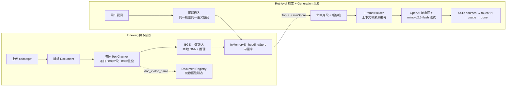

# 📚 TengRAG

**基于 Spring Boot + LangChain4j 的 RAG 知识库问答服务**：文档上传 → 解析 → 切分 → 中文向量化 → 相似检索 → LLM 流式生成 + 引用溯源。

> Java 后端求职作品：完整实现 RAG 的 Indexing / Retrieval / Generation 三阶段，配套 15 个单元测试与 CI。

[](https://github.com/chaiwei-art/teng-rag-java/actions/workflows/ci.yml)


## ✨ 特性

| 能力 | 说明 |
|------|------|
| 📄 文档摄取 | 支持 `.txt` / `.md` / `.pdf`，上传即完成解析→切分→嵌入→入库 |
| 🀄 中文嵌入 | **BGE-small-zh-v1.5，jar 内置 ONNX 模型，纯本地推理**——不依赖任何嵌入 API，离线可用、零成本 |
| 🔍 语义检索 | 余弦相似度 Top-K + 最低分阈值（低于阈值宁可不答，防幻觉） |
| 💬 流式问答 | SSE 逐 token 输出 + 检索耗时/Token 用量统计 |
| 📎 引用溯源 | 回答标注 `[1]` 来源编号，前端展示命中片段与相似度分数 |
| 🧪 离线测试 | 15 个单元测试用桩嵌入模型，不加载 ONNX、不联网，毫秒级跑完 |

## 🏗 架构



### 三阶段职责（面试直接照这个讲）

1. **Indexing**：手写每一步（解析/切分/嵌入/入库）而不用 `EmbeddingStoreIngestor` 一条龙——为了拿到每个向量块的 ID，实现**按文档精准删除**（`removeAll(ids)`）
2. **Retrieval**：查询与文档用**同一个嵌入模型**保证语义空间一致；`minScore` 阈值宁缺毋滥
3. **Generation**：Prompt 强制"只依据上下文作答 + 标注来源编号"，从提示词侧压制幻觉

## 🚀 运行

### 环境要求

- **JDK 17+**（构建与运行）
- 一个 **OpenAI 兼容的 LLM API Key**

```bash
# 1) 构建（JAVA_HOME 指向 JDK17）
export JAVA_HOME="/path/to/jdk-17"     # Windows: set JAVA_HOME=C:\Program Files\Java\jdk-17.0.5
mvn -B package

# 2) 配置 LLM 网关（默认读 OPENAI_API_KEY，可覆盖）
export OPENAI_API_KEY=sk-xxx
# 可选：export LLM_BASE_URL=https://your-gateway/v1
# 可选：export LLM_MODEL=mimo-v2.6-flash

# 3) 启动（默认8080，被占用可换端口）
java -jar target/teng-rag-java-0.1.0.jar --server.port=8081
```

打开 `http://localhost:8081` 即可：左侧对话、右侧上传知识库文档。

### API

| 方法 | 路径 | 说明 |
|------|------|------|
| GET | `/api/health` | 健康检查 |
| POST | `/api/documents` | 上传文档（multipart: file） |
| GET | `/api/documents` | 文档列表 |
| DELETE | `/api/documents/{id}` | 删除文档（向量块级联清理） |
| POST | `/api/chat` | SSE 问答 `{question}` |

**SSE 事件协议**：`sources`（引用来源+相似度）→ `retrieval`（检索耗时）→ `token`×N（增量文本）→ `usage`（token/耗时）→ `done`，异常时 `error`。

## 🧪 测试

```bash
mvn -B test        # 15 例，全部离线运行（桩嵌入模型，不加载 ONNX）
```

| 测试 | 覆盖 |
|------|------|
| `TextChunkerTest` | 切分粒度、重叠、来源元数据（引用溯源的根基） |
| `PromptBuilderTest` | Prompt 结构、来源编号、空检索兜底 |
| `DocumentRegistryTest` | 元数据增删查（未来换 MySQL 时此测试不变 = 接口契约） |
| `RagQueryServiceTest` | **检索排序 / Top-K / 阈值 / 全链路编排**（关键词桩嵌入，可精确断言余弦排序） |

## 🛠 技术选型与踩坑（面试可讲）

- **为什么手写管线不用一条龙 Ingestor**：需要向量块 ID 做级联删除，也为了每一步可测、可讲
- **为什么内存向量库**：MVP 零外部依赖；`EmbeddingStore` 接口不变，生产平移 Milvus/PgVector 只换 Bean
- **为什么本地 ONNX 嵌入**：不依赖嵌入 API（多数 LLM 网关没有 embeddings 端点）、离线可演示、零成本；BGE-zh 对中文语义效果好
- **Windows 踩坑实录**：`onnxruntime.dll 初始化例程失败` 排查——通过 `hs_err` 崩溃日志定位到 **JDK bin 目录夹带的 2021 年旧版 VC 运行库（14.28）抢在 System32 新版（14.50）之前被加载**，改名旧 DLL 后解决（排查过程本身是一次完整的"从崩溃日志到根因"的工程实践）

## 📁 目录结构

```
teng-rag-java/
├── pom.xml
├── src/main/java/com/teng/rag/
│   ├── RagApplication.java
│   ├── config/          # RagProperties 配置绑定 + LangChain4j 装配
│   ├── rag/             # 核心：摄取/切分/检索/编排/流式输出
│   │   ├── TextChunker.java           # 递归切分 + 来源元数据
│   │   ├── DocumentIngestService.java # 解析→嵌入→入库（手写管线）
│   │   ├── RagQueryService.java       # 检索→Prompt→流式编排
│   │   ├── PromptBuilder.java         # 纯函数 Prompt 组装
│   │   ├── LlmStreamer.java           # 流式输出抽象（可换实现）
│   │   └── OpenAiLlmStreamer.java     # OpenAI 兼容网关实现
│   └── web/             # REST + SSE 控制器 + 统一异常
├── src/main/resources/static/index.html  # 极简对话前端（零框架）
└── src/test/java/       # 15 个离线单元测试
```

## 🗺 路线图

- [ ] Redis：问答缓存 + 接口限流（缓存穿透/击穿的面试载体）
- [ ] MySQL：文档元数据与会话历史持久化
- [ ] 离线评测集：20 条标注问答，统计召回命中率
- [ ] Docker Compose 一键部署

## License

MIT
