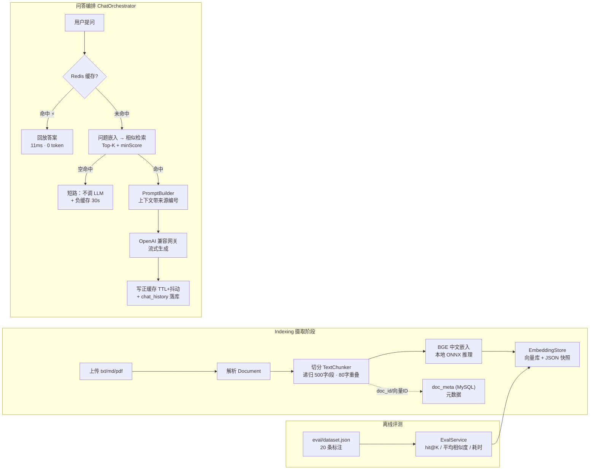

# 📚 TengRAG

**基于 Spring Boot + LangChain4j 的 RAG 知识库问答服务**：文档上传 → 解析 → 切分 → 中文向量化 → 相似检索 → LLM 流式生成 + 引用溯源，配套 **Redis 问答缓存、MySQL 持久化、离线检索评测**。

> Java 后端求职作品：完整实现 RAG 的 Indexing / Retrieval / Generation 三阶段，覆盖缓存三件套、持久化一致性、离线评测等高频面试考点，34 个单元测试与 CI。

[](https://github.com/chaiwei-art/teng-rag-java/actions/workflows/ci.yml)


## ✨ 特性

| 能力 | 说明 |
|------|------|
| 📄 文档摄取 | 支持 `.txt` / `.md` / `.pdf`，上传即完成解析→切分→嵌入→入库；空库自动灌 3 篇种子文档，clone 即可演示 |
| 🀄 中文嵌入 | **BGE-small-zh-v1.5，jar 内置 ONNX 模型，纯本地推理**——不依赖任何嵌入 API，离线可用、零成本 |
| 🔍 语义检索 | 余弦相关度 Top-K + 最低分阈值（relevance=(1+cos)/2，阈值 0.6 要求正相关，宁缺毋滥防幻觉） |
| ⚡ Redis 问答缓存 | 相同问题秒回（实测 11ms vs 首次 12s，0 token）；**TTL+抖动防雪崩、负缓存防穿透、版本号失效防脏读、Redis 挂了自动降级直连** |
| 💾 MySQL 持久化 | 文档元数据 + 问答历史落库（MyBatis-Plus）；向量库 JSON 快照，重启后元数据/向量自动对账一致 |
| 💬 流式问答 | SSE 逐 token 输出 + 缓存命中⚡标识 + 检索耗时/Token 用量统计 |
| 📎 引用溯源 | 回答标注 `[1]` 来源编号，前端展示命中片段与相似度分数 |
| 📊 离线评测 | 20 条标注集统计 hit@K 召回率（纯检索层、零 token），实测 **hit@4 = 100%，平均相似度 0.816** |
| 🧪 离线测试 | 34 个单元测试用桩嵌入模型，不加载 ONNX、不联网，毫秒级跑完 |

## 🏗 架构



### 三阶段职责（面试直接照这个讲）

1. **Indexing**：手写每一步（解析/切分/嵌入/入库）而不用 `EmbeddingStoreIngestor` 一条龙——为了拿到每个向量块的 ID，实现**按文档精准删除**（`removeAll(ids)`）
2. **Retrieval**：查询与文档用**同一个嵌入模型**保证语义空间一致；`minScore` 阈值宁缺毋滥
3. **Generation**：Prompt 强制"只依据上下文作答 + 标注来源编号"，从提示词侧压制幻觉

### 一次提问的决策树（缓存/检索/生成编排）

```
1. 缓存命中？   → 直接回放（sources + 全文一次推），LLM 都不叫，落库 cached=1
2. 检索空命中？ → 短路：不调 LLM（省钱省时），回固定话术 + 负缓存 30s（防穿透）
3. 正常路径    → 流式生成，边收边转发，完成后写正缓存（TTL+抖动）并落库
```

## 🚀 运行

### 环境要求

- **JDK 17+**（构建与运行）
- **MySQL 8.x**（本地 `teng_rag` 库，`spring.sql.init` 自动建表）
- 一个 **OpenAI 兼容的 LLM API Key**
- Redis **可选**：本机没有会自动拉起内嵌实例（embedded-redis），再不行缓存层自动降级

```bash
# 1) 构建（JAVA_HOME 指向 JDK17）
export JAVA_HOME="/path/to/jdk-17"     # Windows: set JAVA_HOME=C:\Program Files\Java\jdk-17.0.5
mvn -B package

# 2) 配置（均有默认值，按需覆盖）
export OPENAI_API_KEY=sk-xxx           # LLM 网关 Key
export MYSQL_PASSWORD=123456           # MySQL 密码
# 可选：export LLM_BASE_URL=https://your-gateway/v1 / LLM_MODEL=mimo-v2.6-flash
# 可选：export RAG_STORE_FILE=data/vector-store.json

# 3) 启动（默认8080，被占用可换端口）
java -jar target/teng-rag-java-0.1.0.jar --server.port=8081
```

打开 `http://localhost:8081` 即可：左侧对话（带⚡缓存标识）、右侧上传知识库文档、顶部"离线评测"按钮一键出报告。

### API

| 方法 | 路径 | 说明 |
|------|------|------|
| GET | `/api/health` | 健康检查 |
| POST | `/api/documents` | 上传文档（multipart: file） |
| GET | `/api/documents` | 文档列表（MySQL） |
| DELETE | `/api/documents/{id}` | 删除文档（向量块 + 元数据 + 缓存级联清理） |
| POST | `/api/chat` | SSE 问答 `{question}` |
| GET | `/api/history?limit=50` | 最近问答历史（MySQL） |
| POST | `/api/eval/run` | 跑离线检索评测，返回召回报告 |

**SSE 事件协议**：`cache`（是否命中⚡）→ `sources`（引用来源+相似度）→ `retrieval`（检索耗时）→ `token`×N → `usage` → `done`，异常时 `error`。

## 🧪 测试与评测

```bash
mvn -B test        # 34 例，全部离线运行（桩嵌入模型，不加载 ONNX）
```

| 测试 | 覆盖 |
|------|------|
| `TextChunkerTest` | 切分粒度、重叠、来源元数据（引用溯源的根基） |
| `PromptBuilderTest` | Prompt 结构、来源编号、空检索兜底 |
| `RagQueryServiceTest` | 检索排序 / Top-K / 阈值 / 全链路编排 |
| `ChatOrchestratorTest` | **缓存命中跳过 LLM / 空命中短路 / 失败不缓存 / 落库标记** |
| `AnswerCachePolicyTest` | 键稳定性、版本隔离、TTL 抖动边界 |
| `InMemoryAnswerCacheTest` | 缓存契约：命中/负缓存过期/版本失效 |
| `InMemoryDocumentMetaStoreTest` | 元数据存储契约（换 MySQL 实现测试不变 = 接口的意义） |
| `EvalServiceTest` | 评测数据集完整性 + 召回指标计算 |

**离线评测**（`POST /api/eval/run`，实测）：20 条标注、**hit@4 = 20/20 = 100%**、平均相似度 0.816、平均检索 32ms。纯检索层评测，零 token 成本，可反复运行对比参数调整。

## 🛠 技术选型与踩坑（面试可讲）

- **为什么手写管线不用一条龙 Ingestor**：需要向量块 ID 做级联删除，也为了每一步可测、可讲
- **为什么本地 ONNX 嵌入**：不依赖嵌入 API（多数 LLM 网关没有 embeddings 端点）、离线可演示、零成本；BGE-zh 对中文语义效果好
- **缓存四设计**：键 = 版本号 + SHA-256（原文不进键）；文档增删 → 版本 INCR 让旧键逻辑失效（免 SCAN 全量删）；TTL 1800s + 300s 随机抖动防雪崩；负缓存 30s 防穿透；Redis 异常一律降级为"未命中"——缓存是加速器不是可用性单点
- **元数据/向量重启一致性**：doc_meta 在 MySQL、向量在内存，重启会"列表有、检索空"——向量库 `serializeToFile` 快照 + 启动对账（快照丢→清陈旧行重灌种子；无主向量→清向量）
- **relevance 分数量纲**：LangChain4j 分数 = (1+cos)/2，正交=0.5——`minScore=0.35` 形同虚设，改 0.6 才真正过滤无关内容（由单测正交向量命中失败反推出来）
- **Windows 踩坑实录**：
  - `onnxruntime.dll 初始化例程失败`——`hs_err` 崩溃日志定位到 **JDK bin 夹带的 2021 年旧版 VC 运行库（14.28）抢在 System32 新版（14.50）之前加载**，改名旧 DLL 解决
  - 本机装 Redis：Memurai MSI 1603、winget Redis 从 GitHub 下载被墙 → 改用 **embedded-redis（阿里云镜像可拉）**，启动时探测 6379，没有就自动拉内嵌实例
  - mysql-connector-j 9.x 的 `characterEncoding` 要 Java 字符集名（`UTF-8`），写 MySQL 字面量 `utf8mb4` 直接 `Unsupported character encoding`

## 📁 目录结构

```
teng-rag-java/
├── pom.xml
├── src/main/java/com/teng/rag/
│   ├── RagApplication.java            # 入口（RedisBootstrap 先于容器）
│   ├── config/          # 配置绑定 + LangChain4j 装配 + Redis 引导
│   ├── cache/           # 问答缓存：策略/接口/内存实现/Redis 实现
│   ├── store/           # 持久化：实体/Mapper/接口+双实现/向量快照
│   ├── mapper/          # MyBatis-Plus Mapper
│   ├── eval/            # 离线检索评测（Retriever 抽象 + 指标统计）
│   ├── rag/             # 核心：摄取/切分/检索/编排/流式/种子初始化
│   └── web/             # REST + SSE 控制器 + 统一异常
├── src/main/resources/
│   ├── static/index.html             # 极简对话前端（零框架）
│   ├── samples/*.md                  # 3 篇种子文档（空库自动灌）
│   ├── eval/dataset.json             # 20 条标注评测集
│   └── schema.sql                    # doc_meta / chat_history 建表
└── src/test/java/       # 34 个离线单元测试
```

## 🗺 路线图

- [x] Redis：问答缓存（穿透/击穿/雪崩三件套 + 降级）
- [x] MySQL：文档元数据与问答历史持久化
- [x] 离线评测集：20 条标注问答，hit@K 统计
- [x] 向量快照 + 启动对账（重启一致性）
- [ ] Docker Compose 一键部署
- [ ] 向量库平移 PgVector/Milvus（接口已就绪，换 Bean 即可）

## License

MIT
